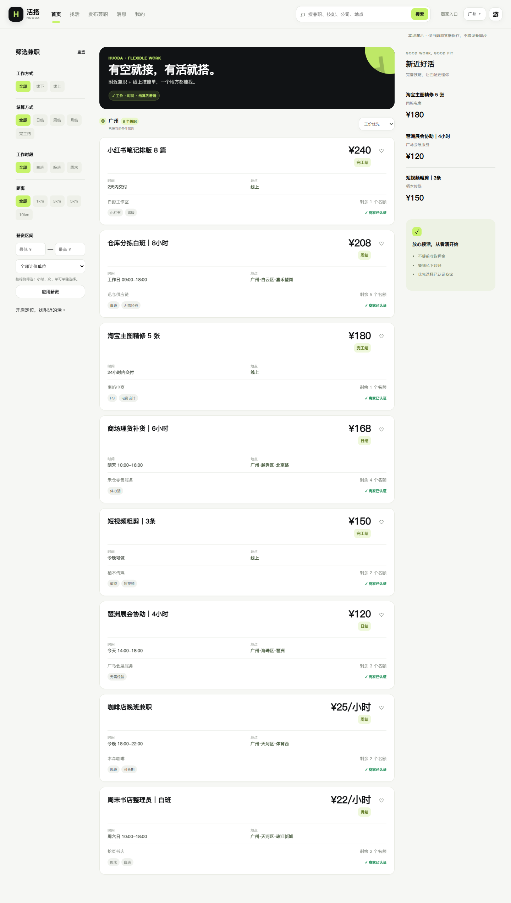
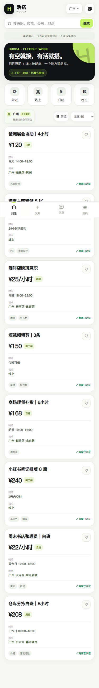

# 活搭 HUODA

面向本地兼职和线上任务的响应式 Web 应用，帮助求职者找活、报名和沟通，也让商家发布任务、管理报名并处理合作评价。

**当前包版本：0.5.4（5.4）。状态：非商业源码公开准备，尚未对外发布。** 源码和自动化覆盖已存在；真实 Supabase、生产部署及跨设备验收需要在隔离环境另行验证。支付、资金托管和提现未接入。

> **项目自有部分采用 [PolyForm Noncommercial License 1.0.0](LICENSE)。** 接收者可按该许可证为非商业目的使用、修改和分发；商业用途未在此获得授权。许可原文明确允许慈善、教育、公共科研、公共安全/卫生、环保及政府机构使用，具体以其允许用途、组织条款和法定权利为准。
>
> **这是带用途限制的“源码可见”项目，不属于 OSI 定义的标准开源。** 非商业限制不改变第三方 MIT/Apache/BSD 代码本身的原有权利；第三方许可见 [第三方声明](THIRD_PARTY_NOTICES.md)。范围和示例见 [许可说明](docs/LICENSING.md)，当前状态见 [公开准备报告](OPEN_SOURCE_READINESS_REPORT.md)。

## 功能与开发状态

| 模块 | 源码中的实现 | 当前边界 |
|---|---|---|
| 找活 | 游客浏览、关键词搜索、线上/附近、薪资筛选与分页 | 附近基于 WGS84，定位需用户授权 |
| 任务发布 | 草稿、提交审核、修改、招满、结束和下架 | 云端需要认证商家及管理员 |
| 报名 | applied → viewed → communicating → accepted → completed，及 rejected/cancelled | 名额与权限由数据库 RPC/RLS 校验 |
| 沟通 | 会话、历史分页、未读、已读、通知、账号切换保护 | Realtime 触发重读；真实网络未在本次验收 |
| 个人与商家 | 档案、收藏、合作评价、举报、认证材料 | 私有材料依赖 Storage 策略与后台函数 |
| 审核后台 | 独立 /admin/，商家认证、任务审核、举报处理 | 本地为模拟审核；云端验证管理员身份 |
| 资金相关 | 界面入口提示尚未接入 | 无真实支付、托管或提现 |
| 履约统计 | 有评价和完成单数数据路径 | 工资及时率及投诉统计暂无真实数据 |

本地演示任务、用户和交互记录是匿名测试夹具，不是生产订单、真实用户或社区采用证明。

## 技术栈

- 前端：原生 HTML、CSS、JavaScript；Hash 路由，一套界面适配手机、平板和 PC。
- 数据访问：Supabase JS **2.57.4**；Auth、PostgreSQL、PostGIS、RPC/RLS、Realtime、私有 Storage。
- 后台：Supabase Edge Function（TypeScript / Deno），没有独立 Express 或其他常驻 Node 后端。
- 工程：Node.js 22、npm lockfile；PGlite **0.3.14** 与 Playwright **1.55.1** 自动化。
- 可选部署：Vercel 静态输出；生产构建使用公开浏览器连接参数，发布目录为 dist。

## 目录

```text
.
├─ index.html / app.js / *.css       用户端、路由、现有界面
├─ admin/                           审核页面与后台 Service
├─ src/core/                        服务注册、启动与同步
├─ src/services/                    Auth、任务、报名、消息等服务
├─ src/pages/                       消息、档案及响应式页面
├─ LICENSE                          项目自有部分的标准非商业许可证
├─ config.example.js                无密钥的本地配置示例
├─ .env.example                     构建/隔离集成测试变量模板
├─ supabase.sql                     新数据库所需的基线 SQL
├─ supabase/migrations/              CLI 基线与 001–006 增量迁移
├─ supabase/functions/admin-review/  管理员 Edge Function
├─ scripts/                         localhost 服务、检查、构建与产物校验
├─ tests/                           SQL/RLS、服务、浏览器及部署测试
├─ vendor/                          Supabase UMD 与完整许可声明
├─ docs/                            迁移、历史记录、授权与申请准备
└─ .github/                         CI、Issue 与 PR 模板
```

## 五分钟本地演示

需要 **Node.js 22（本次使用 22.14.0）**、npm 和现代浏览器。基本演示不需要私人账号、数据库或云端密钥。

在本源码目录打开终端：

```sh
npm ci --ignore-scripts
npm start
```

打开 [用户端](http://127.0.0.1:8085/) 或 [本地审核演示](http://127.0.0.1:8085/admin/)。
也可以双击“启动活搭.cmd”。服务只监听 127.0.0.1；请通过 localhost/HTTPS 使用，避免直接双击 HTML。

缺少 config.js 时，开发服务向 /config.js 提供匿名演示模板，不创建或覆盖配置文件。需要自定义城市或接入云端时，首次复制模板：

```powershell
if (-not (Test-Path config.js)) { Copy-Item config.example.js config.js }
```

Linux/macOS 可执行 `test -e config.js || cp config.example.js config.js`。已有 config.js 优先使用。

**演示模式只存当前浏览器 LocalStorage。演示密码不验证，后台审核为模拟操作，请勿填真实个人信息或业务材料。** 不同设备、浏览器或来源地址之间不会同步演示记录。

## 云端配置与生产构建

云端 config.js 只填写 Project URL 与 publishable/anon key。它们属于浏览器公开连接信息，数据保护必须依赖 Auth/RLS/Storage 策略。部分配置或云端连接失败会显示错误，不会偷偷切回演示数据。

1. 按 [迁移说明](MIGRATION.md) 在隔离开发项目执行 CLI 基线迁移 202609090000_base_schema.sql，再执行 001–006。根 supabase.sql 是同一份基线的审阅副本，不要重复执行；已有数据库只追加尚未执行的迁移。
2. 配置 Auth 重定向、私有 Storage，部署 admin-review 并设置 ADMIN_ALLOWED_ORIGINS。
3. 管理员账号由可信管理流程写入 admin_users，前端不能授予权限。
4. 在本地安全配置环境变量，或在 Vercel 设置公开构建变量：

```powershell
$env:HUODA_SUPABASE_URL="https://YOUR_PROJECT.supabase.co"
$env:HUODA_SUPABASE_PUBLISHABLE_KEY="sb_publishable_YOUR_PUBLIC_KEY"
npm run build
npm run verify:dist
```

占位值必须替换为自己隔离项目的公开连接值。缺少两项参数、仅提供一项或传入高权限密钥时，生产构建失败。城市与默认坐标可选，参见 [.env.example](.env.example)。

.env.example 仅是模板，npm start/build **不会自动读取 .env**。若自行创建了忽略的 .env，可使用 Node 22 的 `node --env-file=.env scripts/build.cjs`；不要把高权限密钥放入该文件。

只想检查静态输出时：

```sh
npm run build:demo
npm run verify:dist
```

build:demo 的 dist 明确标记 local-demo，不适合承载真实业务。构建会重建 dist，请先保留需要的旧构建。只发布 dist 白名单内容，不发布 SQL、测试、脚本、.env 或整个源码目录。
Vercel 设置已有 vercel.json；发布动作由仓库所有者另行确认。

数据库密码、service_role、sb_secret_、管理员密码不得进入浏览器、源码、Git 或构建变量。进一步说明见 [云端接入](docs/云端接入_从这里开始.md)。

## 检查与测试

```sh
npm run check
npm run check:migrations
npm run check:publication
npx playwright install chromium
```

保持一个终端运行 npm start，另一个终端执行：

```sh
npm test
npm run build:demo
npm run verify:dist
npm audit --audit-level=high
```

也可把 BROWSER_PATH 指向已安装的 Chrome/Chromium，避免下载浏览器。完整步骤及验证边界见 [TESTING.md](TESTING.md)。

数据库自动化使用 PGlite 和空间函数替身；云端浏览器测试使用本地传输适配器。它们不能证明真实 PostGIS、Auth 邮件、WebSocket、Storage、Edge Function、公网或实体设备验收通过。本次结果以 [开源准备报告](OPEN_SOURCE_READINESS_REPORT.md) 为准；旧报告保留其原始日期。

## 常见问题

- **安装失败**：确认 Node 22 与 npm，使用锁文件执行 npm ci；不要随意执行 npm audit fix --force。
- **端口被占用**：关闭你自己启动的旧服务，或使用 PORT 变量另选端口。完整自动化目前固定访问 8085。
- **云端报错**：同时检查 URL 与公开 key、Auth 重定向、迁移顺序及 RLS；不要关闭 RLS 规避错误。
- **后台拒绝登录/操作**：本地演示与云端权限不同；云端需要 admin_users、已部署函数及允许的 Origin。
- **数据看起来丢失**：演示数据按浏览器与来源地址保存，云端数据按登录账号及权限读取。
- **构建缺少配置**：本地查看用 build:demo，生产需两项公开配置；不允许发布时自动回退。
- **浏览器测试无法启动**：安装对应 Chromium 或设置 BROWSER_PATH；Linux CI 需 Playwright 系统依赖。
- **源码包与仓库历史**：最初交付包源于 071de19 且无 .git；当前仓库在 94754e1 基础上合入整理结果并保留原历史，见 [私有仓库更新记录](docs/PRIVATE_REPOSITORY_UPDATE.md)。打包命令导出的快照仍不含 .git。

## 实际演示截图

以下为 2026-10-21 本机 Chrome 在匿名演示模式下由既有响应式测试生成的截图，包含演示任务，不能代表真实商家或生产采用。

<details>
<summary>查看桌面与手机演示截图</summary>

桌面 1440 像素：



手机视口 375 像素（浏览器模拟）：



</details>

没有在本次确认公网演示地址。

## 源码候选包

执行 `npm run check:publication` 检查许可、元数据、常见敏感模式及分发边界；执行 `npm run prepare:publication` 生成无 Git 历史的源码候选包与逐文件哈希清单。输出位于 .local/publication-candidate，已存在时拒绝覆盖。

公开前请阅读 [交接清单](docs/PUBLICATION_CHECKLIST.md) 和 [发布操作说明](docs/PUBLISHING.md)。这些本地命令不上传代码，也不修改 GitHub 可见性。已知的上游许可标注差异记录在 [第三方清单](docs/THIRD_PARTY_INVENTORY.json) 中。

## 本次私有仓库更新

维护者已授权将整理版更新至现有 hedawang01-dev/huoda 私有仓库，最后由本人手动公开。包版本保留 0.5.4，不虚构新的业务版本或公开 Release；当前提交与检查状态以仓库为准。

本版保留 94754e1 的七个迁移事务、CLI 基线、迁移检查、Supabase CLI 2.117.0 与测试夹具兼容修复，并合入非商业许可和公开准备。源码打包额外排除 Supabase CLI 的 supabase/.temp 连接元数据。原有 [2026-09-12 部署记录](docs/V054_Supabase部署报告.md) 为历史证据，本次没有连接生产 Supabase 重验或更改数据。

更新范围和验证见 [私有仓库更新记录](docs/PRIVATE_REPOSITORY_UPDATE.md)；旧交付包是其各自阶段的快照，不替代本版迁移说明。

## 维护与后续计划

GitHub 维护账号为 [hedawang01-dev](docs/MAINTAINERS.md)。维护者已说明项目自建代码、文案和品牌素材由其使用 Codex 辅助生成；[来源说明](docs/AI_PROVENANCE.md) 记录条款依据及第三方许可边界，不宣称全部纯人工原创、注册商标或所有 AI 输出必然有版权。
当前可进入人工审核和公开确认阶段，最终发布仍由所有者亲自决定。安全邮箱可选，计划公开后启用并验证 GitHub 私密漏洞报告，当前入口未启用。源码公开与真实业务上线分别审核；真实服务还需隔离 Supabase 的 Auth/RLS/Storage/后台/并发验收。
后续完善无障碍人工验收、更多数据库边界测试和社区反馈；支付及资金功能需要单独设计，当前不承诺上线时间。

欢迎按 [贡献指南](CONTRIBUTING.md) 报告可复现问题和提交小范围改动。安全漏洞请看 [SECURITY.md](SECURITY.md)，不要发公开凭据。
历史更新见 [CHANGELOG.md](CHANGELOG.md)；[OpenAI 申请资料](docs/CODEX_OSS_APPLICATION.md) 记录真实证据及非商业许可影响；当前不能以标准开源项目口径提交，不表示符合或获得六个月 Pro 权益。
