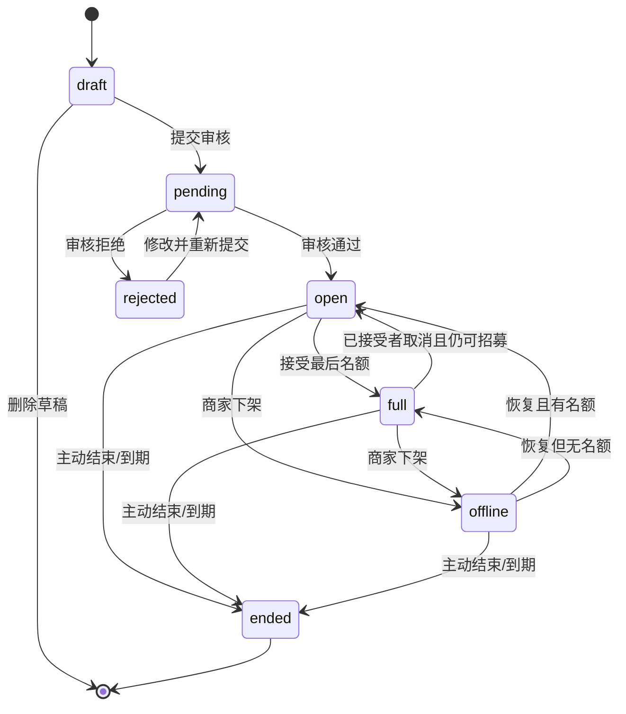
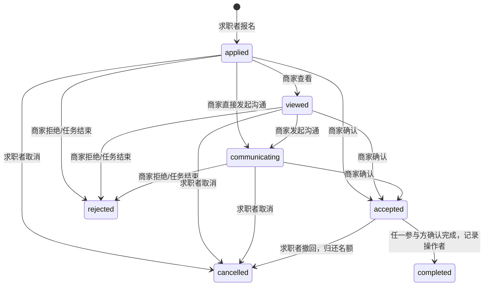

# HUODA v0.5.4 后端审计与 006 增量设计

> 本文是实施前审计和方案记录。006 最终实现、Service 接入及验证结果见 `V054_升级与验收报告.md`；文末“等待实施”的表述仅记录阶段一状态。

> 审计日期：2026-09-12  
> 基线：`v5.3-stable` / `6a95a0a0fda1d341b2555e11e82f1bdfeaea8436`  
> 范围：全部 Supabase SQL、001–005 迁移、`admin-review` Edge Function、`src/services` 下 11 个服务  
> 本阶段性质：只读审计和增量设计；未修改旧迁移、Edge Function、前端或业务服务

## 1. 结论先行

v5.3 已有一套比较完整的 Supabase 后端骨架：Auth 用户触发器、PostgreSQL 业务表、RLS、`SECURITY DEFINER` RPC、私有商家执照存储、管理员 Edge Function，以及消息/通知 Realtime publication 都已在仓库中定义。报名和确认占用名额也已放在数据库事务中，并用“先锁任务、再锁报名”统一了锁顺序。

但当前 `config.js` 的 Supabase URL 和公开 key 仍为空，实际运行会进入 `localStorage` 演示模式。仓库内也没有可以证明 001–005、Storage policy、Realtime publication 和 Edge Function 已部署到某个真实 Supabase 项目的验收记录。因此准确状态是：**云端后端已在代码和 SQL 中定义，但当前应用仍是本地 mock，不能声称 Auth / Database / Realtime / Storage 已真实连通。**

v5.4 不需要换技术栈或重建数据模型。应使用单个增量 `202609120006_v054_backend.sql`，保留已有表和 RPC 签名，补齐草稿、任务上下架/结束、报名查看/沟通、截止时间、隐私权限、Realtime 覆盖和必要索引。付款不在 v5.4 范围内，不建支付表、余额表或结算 RPC。

## 2. 当前真实数据路径

| 运行面 | 仓库中已定义 | 当前实际状态 | v5.4 必须补齐 |
|---|---|---|---|
| Auth | Supabase email/password 注册、登录、退出；`auth.users` 触发创建 profile | URL/key 为空时使用本地假用户和 `active` 标记 | 填写真实项目配置，验证邮箱确认、会话恢复、跨设备退出 |
| Database | PostgreSQL 表、RLS、RPC、审计日志 | 本地模式使用 `huoda_mvp_v050` JSON | 部署 001–006，在真库做并发、RLS 和回填验收 |
| Realtime | `messages` / `notifications` 已加入 publication | 仅云端模式订阅；当前未启用 | 增加 `tasks` / `applications` / `favorites`，前端仍按“变更通知后重读权威数据”处理 |
| Storage | 私有 `merchant-verification` bucket，10MB，JPG/PNG/PDF | 云端时可上传；本地只记文件名 | 做真实上传、跨账号隔离、管理员 60 秒签名 URL 验收 |
| Edge Function | `admin-review` 验 JWT、查 `admin_users`、用 service role 审核 | 代码存在，无真实部署证据 | 配置精确的 `ADMIN_ALLOWED_ORIGINS`，部署并验证审计链 |

本地 mock 是明确的演示降级路径，不是云端缓存。一台设备的本地数据不会同步到另一台设备，也不能与真实账号数据合并。

## 3. 实体持久化、状态和权限盘点

| 实体 | Supabase 持久化 | 本地 mock | 当前状态/约束 | 当前权限 | 关键缺失 |
|---|---|---|---|---|---|
| 账号 | `auth.users` | `users[]` + `active` | email/password；新用户固定创建 worker profile | Auth 托管；业务表以 `auth.uid()` 鉴权 | 真项目未接入；未验收邮箱确认/找回密码 |
| 基础档案 | `profiles` | `users[]` | `current_mode=worker/merchant`；历史 `role/verified` 仍保留 | 登录用户只直读自己的白名单列；公开档案走 RPC | 无 `updated_at`；历史字段和新字段语义重叠 |
| 求职者档案 | `worker_profiles` | `users[]` 展平字段 | bio、skills | 本人直读；他人通过 `get_public_profile` | skills 没有单项长度与标准化约束 |
| 商家档案 | `merchant_profiles` | `users[]` + `verificationRequests[]` | `unverified/pending/verified/rejected` | 本人直读；提交走 RPC；审核仅 service role + `admin_users` | 云端部署未验收；认证重提缺少原因/版本字段 |
| 任务草稿 | 无 | 发布表单草稿在 `sessionStorage` | 无服务端状态 | 仅当前浏览器会话 | 不持久、不跨设备；必须新增 `task_drafts` |
| 任务 | `tasks` | `tasks[]` + 8 条 seed | `status=open/paused/closed/completed`；`review_status=pending/approved/rejected` | 游客只读 approved + open + 有名额；owner/参与者可读隐藏任务；写入走 RPC | 无草稿、下架、恢复、主动结束 RPC；`end_at` 不生效 |
| 报名 | `applications` | `applications[]` | `applied/accepted/rejected/completed/cancelled`；唯一 `(task_id,worker_id)` | 只有 worker/merchant 参与方可读；状态写入走 RPC | 无 viewed/communicating；completed 的操作者未限制 |
| 消息 | `messages` | `messages[]` | text/system/image，1–2000 字，单一 `read_at` | 只有报名参与方可读；文本发送走 RPC | 仅 accepted/completed 可聊；image/attachment 只有字段没有完整上传契约 |
| 会话收件箱 | `get_message_inbox` 动态聚合 | 每次从本地报名/消息计算 | accepted/completed 或已有文本消息时可见 | 必须登录，仅本人会话 | 无 communicating 阶段；消息全文搜索为相关子查询，大数据量会慢 |
| 举报 | `reports` | `reports[]` | `open/resolved/dismissed` | 用户只读自己并通过 RPC 提交；管理员处理 | 无重复/频率限制；管理列表索引不匹配 |
| 收藏 | `favorites` | 登录用户 `favoritesByUser`；游客另有 `huoda_favorites_v050_guest` | 联合主键防重 | 登录用户只能 CRUD 自己记录 | 现在允许游客本地收藏，与“收藏需登录”目标冲突 |
| 评价 | `reviews` | `reviews[]` | 完成后双方各一次，1–5 分 | 当前 `anon/authenticated` 可直接读全表 | **公开暴露 reviewer/reviewee/application UUID 关系，必须收紧** |
| 通知 | `notifications` | `notifications[]` | type + JSON data + `read_at` | 仅用户本人读；已读走 RPC | 没有保留/归档策略；重试可能产生重复通知 |
| 审计日志 | `audit_logs` | `audit_logs[]` | actor/action/target/before/after | 客户端无读写权，service role 可访问 | 无 request/correlation/idempotency key；无保留策略 |
| 管理员 | `admin_users` | 本地 admin 适配器 | UUID 白名单 | 客户无权；Edge 验证 Auth 用户后再查表 | 首个管理员需 DBA 手工授权；无角色分级 |
| 商家执照 | Storage `merchant-verification` | 仅文件名 | 私有、10MB、JPG/PNG/PDF、UUID 目录 | 本人可上传/读，不可更新删除；管理员经 Edge 取 60 秒 URL | 必须检查目标库是否存在其他宽泛 Storage policy |
| 头像/聊天附件 | 头像仅 HTTPS URL；消息有 `attachment_path` 字段 | 头像 URL/消息字段 | 无完整 Storage 流程 | 无 | v5.4 保持 UI 时不宣称这两项已实现；Storage 验收范围以商家执照为准 |

## 4. `src/services` 逐项审计

| 服务 | 云端路径 | 本地路径 | 判定 |
|---|---|---|---|
| `authService` | 直读自己 profile，写入走 `save_my_profile` | 改 `users[]` | 身份世代隔离做得比较完整；云端未激活 |
| `taskService` | 搜索走两个 RPC，详情直读 RLS，发布走 `create_task` | 本地搜索/发布 | 无草稿和生命周期动作；过期任务仍可见/可报 |
| `applicationService` | `apply_to_task` / `transition_application` / `accept_application` | 复制 SQL 状态机 | 并发占位已在 DB；缺 viewed/communicating；任一参与方均可 completed |
| `messageService` | `send_text_message` / `mark_conversation_read`；订阅 messages/notifications | 本地消息与通知 | 仅接受后可聊；订阅没有覆盖任务/报名 |
| `inboxService` | `get_message_inbox` + `get_conversation_messages` 游标分页 | 完整本地聚合 | 消息历史分页和会话未读较稳健；新 communicating 阶段需扩展 |
| `notificationService` | `mark_notification_read` | 本地更新 | 权限正确；无幂等/归档 |
| `favoriteService` | 直接 RLS CRUD，登录后合并游客收藏 | 游客 localStorage + 账号本地列表 | 与 v5.4 “收藏必须登录”冲突；合并最多会产生 500 次串行请求 |
| `reviewService` | `submit_review` | 本地提交 | 写入边界正确；读取 RLS 过宽 |
| `merchantService` | 公开档案 RPC；私有 Storage 上传；认证 RPC | 只存文件名/申请 | 是 Storage 的唯一完整业务入口；需真环境验收 |
| `locationService` | 坐标随搜索 RPC 发送，不持久 | 浏览器 Haversine 计算 | 设计符合当前最小化原则；公开精确任务坐标需产品确认隐私精度 |
| `recommendationService` | 使用 SQL 返回分数 | 本地重算 | 仅规则分，不持久用户位置；无独立后端缺口 |

## 5. SQL、迁移与 Edge Function 审计

### 5.1 `supabase.sql`

这是 v0.3/v0.4.3 基线脚本，创建 profiles/tasks/applications/messages/reports，含早期 RLS 和触发器。早期版本曾授权普通客户直接 INSERT/UPDATE 任务和报名，对状态的保护不足。001 已撤销这些写权并改为 RPC 边界。现有库不能重跑 `supabase.sql`，否则会重新引入旧契约风险。

### 5.2 `202609100001_v050_foundation.sql`

该迁移完成了主体加固：拆分 worker/merchant profile，引入分值金额、PostGIS、favorites/reviews/notifications/audit/admin，重建 RLS，并把关键写操作收口到 RPC。报名确认在任务行锁下扣减名额，并保留 `(task_id,worker_id)` 唯一约束，可以阻止最后名额并发超卖。

主要缺口是任务无主动下架/结束 RPC、`end_at` 未参与搜索和报名条件、completed 无操作者限制，以及 reviews 全表公开。

### 5.3 `202609100002_task_edit.sql`

`edit_task_details` 会阻止修改已有 accepted/completed 人员的任务，并让修改后的任务重新进入 pending，这个原则应保留。但它对任务当前 lifecycle 没有限制；在历史异常数据下，已结束任务只要没有 accepted/completed 记录也可重新送审。006 应限制可编辑集合。

### 5.4 `202609100003_message_inbox.sql`

收件箱在服务端基于完整消息历史计算未读和最新消息，比前端只取200条后推断更可靠。它仍只认 accepted/completed 或已有文本消息的会话。全文搜索使用每个会话关联扫描 `messages.content`，需要限制会话数/搜索频率，后续再评估 `pg_trgm` 或搜索投影。

### 5.5 `202609100004_desktop_sync.sql`

新搜索 RPC 兼容旧搜索，加了金额/单位过滤。`sync_merchant_task_badges` 把 `tasks.verified` 定义为“商家已认证”的公开缓存。但 001 中的 `admin_moderate(task, rejected)` 仍会把 `tasks.verified` 写成 false，造成“商家已认证，但被拒的任务显示商家未认证”的语义冲突。006 必须替换 `admin_moderate` 函数体，任务审核只更新 `review_status`，`verified` 始终从 merchant profile 同步。

### 5.6 `202609110005_service_hardening.sql`

`get_conversation_messages` 使用 `(created_at,id)` 键集游标，只允许报名参与方读取，单页最多 200 条。这一块契约和索引可直接保留。

### 5.7 `admin-review` Edge Function

Edge Function 使用真实 Auth `getUser(token)` 校验会话，再查 `admin_users`，然后以 service role 调用数据库审核 RPC；没有把 service key 下发前端。这个边界正确。风险点是默认 CORS 只适用 `127.0.0.1:8085`，生产不配 allowlist 会不可用；审核失败时把数据库 `error.message` 放到对外 `code`，应映射到稳定错误码。列表固定最多 100 条且无游标，是运营规模扩大后的缺口。

### 5.8 `seed.sql` 与 `config.toml`

`seed.sql` 只针对测试项目，要求先在 Auth 创建 merchant/worker/admin 三个明确的 `.test` 邮箱，不包含密码或 service key，重复执行不会重复创建固定 UUID 任务。它不能运行在生产库。`config.toml` 只为 `admin-review` 开启 `verify_jwt=true`；这是第一道校验，Edge 内部 `getUser` + `admin_users` 是第二道授权。

## 6. 现有漏洞与发布阻断项

### P0：v5.4 真后端验收前必须解决

1. **当前运行仍是本地 mock。** 空 URL/key 使所有业务数据落在浏览器，无跨设备、无真 RLS、无真 Storage/Realtime。
2. **`reviews` 原始关系全公开。** `review_read using(true)` 与 anon SELECT 会暴露评价人、被评人和报名 UUID。006 应撤销 anon 直读，authenticated 只读自己写的评价；公开展示继续走白名单 RPC。
3. **截止时间没有执行力。** 任务 `end_at` 过去后仍可搜索和报名。查询和报名 RPC 都必须以 `end_at is null or end_at > now()` 为强制条件，并有后台批处理把过期任务持久化为 ended。
4. **completed 可被任一参与方单方写入。** 当前 `transition_application` 只检查参与身份，求职者或商家都能从 accepted 直接完成。v5.4 建议明确为双方都可发起，但要记录 `completed_by`；若产品要求双方确认，则需额外 confirmation 字段，不应暗中改变现有行为。本设计为保持 UI，采用“双方均可完成 + 记录操作者”。
5. **`tasks.verified` 存在两种写入语义。** 004 将其定义为商家认证徽标，001 的任务审核仍按任务通过/拒绝修改它。必须统一为商家徽标。
6. **游客可本地收藏。** v5.4 要求游客只浏览，收藏等操作需登录。第二阶段服务层必须在 toggle 前触发 Auth，不再写新的 guest favorite；旧 guest 键只做一次性迁移提示或忽略，不静默上传。

### P1：功能和一致性缺口

1. 任务无 draft/publish/offline/relist/end 服务端状态机，前端无法可靠操作。
2. 报名无 viewed/communicating，且聊天被限制在 accepted 之后，不符合 v5.4 沟通流程。
3. Realtime 仅发布 messages/notifications；任务名额、上下架和报名状态主要靠 focus/15 秒轮询。
4. 已拒绝/已取消的 worker 仍被 `is_task_participant` 视为永久参与者，可继续读取任务全字段。应明确这是“历史订单可回看”的产品政策，否则收紧为非 rejected/cancelled 或另建历史白名单投影。本设计保留历史回看，但公开投影不应包含不必要的精确坐标。
5. `create_task` 的 tags/category/shift/settlement/price_unit 缺少完整长度和 allowlist；举报、消息、搜索没有频率约束或幂等 key。
6. 搜索使用 offset cursor，在持续新增/上下架时可重复或跳过记录。v5.4 可保留兼容，后续增加 `(sort_key,created_at,id)` 键集分页。

### P2：规模化前应补的索引/运维能力

- 增加 `applications(merchant_id,created_at desc)`，当前商家侧列表缺合适索引。
- 增加 `favorites(task_id)` 支持任务删除时的外键检查/级联删除。
- 增加 `reports(status,created_at)` 支持管理员待审列表。
- 增加任务截止时间的部分索引，支持过期批处理。
- 结构化日志增加 request/correlation/idempotency 标识，设定 audit/notification 保留期和告警。

## 7. v5.4 兼容状态模型

### 7.1 任务业务态映射

不把业务态 `offline` 直接写入 `tasks.status`，因为现有 `tasks.type='offline'` 已表示“线下任务”。为了保持旧 UI 和查询条件，使用下列映射：

| v5.4 业务态 | 真实持久化 | 判定/含义 |
|---|---|---|
| `draft` | `task_drafts` 独立行 | 可不完整，只有 owner 可见，不进审核队列 |
| `pending` | `tasks.status='open' AND review_status='pending'` | 已提交平台审核，游客不可见/不可报 |
| `open` | `status='open' AND review_status='approved' AND spots_left>0 AND (end_at IS NULL OR end_at>now())` | 可公开浏览和报名 |
| `full` | `status='closed' AND review_status='approved' AND spots_left=0` | 系统因接受最后一个名额自动进入 |
| `ended` | `status='completed'` 或 `end_at<=now()` 的有效派生态 | 永久停止新报名；后台批处理最终将过期行写成 completed |
| `offline` | `status='paused' AND review_status='approved'` | 商家临时下架，可恢复；不影响已确认合作 |

`review_status='rejected'` 是平台审核结果，不硬塞进六个 lifecycle 态。owner 界面应显示“审核未通过”，修改后可重新送审。



### 7.2 报名业务态

为了不破坏旧客户端对 `status==='applied'` 的按钮判断，006 不把 viewed/communicating 直接改成 `applications.status` 新值。新增 `viewed_at` 和 `communicating_at`，再新增只读生成列 `phase`：

```text
status in accepted/rejected/completed/cancelled -> phase = status
status = applied and communicating_at is not null -> phase = communicating
status = applied and viewed_at is not null -> phase = viewed
otherwise -> phase = applied
```

这样新客户端显示 `phase`，老客户端仍看到 `status='applied'` 并可继续接受/拒绝，RPC 签名也不需破坏。



`rejected/completed/cancelled` 为终态。同一 worker 不能在取消或被拒绝后重复报同一任务，继续使用现有唯一约束。

## 8. 名额事务、结束、下架和草稿规则

### 8.1 名额不变式

```text
spots_left = spots_total - count(applications where status in ('accepted','completed'))
0 <= spots_left <= spots_total
```

- applied/viewed/communicating/rejected/cancelled 不占名额。
- accepted 在事务中占一个名额；completed 继续占用历史名额，不归还。
- 确认、取消、结束统一先 `SELECT task FOR UPDATE`，再 `SELECT application FOR UPDATE`，不得反向锁定。PostgreSQL 行锁使第二个并发确认等待第一个事务，然后重新检查名额。
- 接受最后一人时将 `status` 从 open 写成 closed，对外 phase 为 full。
- accepted 取消时归还一个名额；只有原状态是 closed、任务已审核通过、未过期时才自动恢复 open。paused/completed 绝不自动上架。
- `apply_to_task` 和 accepted 分支必须同时检查 approved、open、有名额和未过期，不依赖前端状态。

### 8.2 下架规则

- 只有 owner 可下架 approved 的 open/full 任务，写为 `status='paused'`，记录 `offline_at/offline_reason`。
- 下架后不接收新报名，但保留已有报名、沟通、accepted 合作和聊天。
- 恢复时重新检查 approved、未过期和名额；有名额写 open，无名额写 closed。
- pending/rejected 是审核态，不接受“下架”动作；草稿也不使用下架。

### 8.3 结束规则

- owner 可将 approved 的 open/full/offline 任务主动结束，写 `status='completed'` 与 `ended_at`；结束是终态，不能恢复。
- 结束时把 applied/viewed/communicating 统一转为 rejected，写 `decision_reason='task_ended'`，发通知和审计。accepted/completed/cancelled/rejected 保持原状态。
- 任务结束后，accepted 参与方仍可聊天、取消或完成；取消归还数字但不恢复任务。
- 任何查询/报名都先以 `end_at` 阻断过期任务。再由只限 service role 的小批量 `expire_tasks(p_limit)` 定时持久化 ended；即使定时任务延迟，也不会超期报名。

### 8.4 草稿规则

- 新增 `task_drafts(id,owner_id,payload,created_at,updated_at)`，不放宽现有 `tasks` 必填列和检查约束。
- 任何已登录用户可保存本人草稿；提交时必须是 verified merchant。这允许用户先写内容，再完成商家认证。
- `payload` 只允许任务可编辑字段，拒绝 owner/status/review_status/verified/spots_left 等服务端字段，整体限制为 64KiB。
- 保存可不完整；提交时在一个事务内执行完整校验，以同一 UUID 插入 `tasks(status='open',review_status='pending')`，再删除草稿。
- 草稿只有 owner 可读/写/删，游客、其他用户、审核队列和公开 Realtime 都不可见。

## 9. 兼容 RPC 契约

原则：旧函数名、参数名、返回类型和默认行为保留；006 只替换函数体或新增函数。安全函数继续固定 `search_path=public,extensions,pg_temp`，撤销 PUBLIC 默认 EXECUTE 后按角色授权。错误保持稳定大写代码，前端不解析自由文本。

### 9.1 保留签名、扩展函数体

| RPC | 调用角色 | v5.4 契约 | 兼容性 |
|---|---|---|---|
| `search_nearby_tasks(...) -> jsonb` | anon/authenticated | 新增未过期条件，继续只返回 open/approved/有名额 | 参数和 envelope 不变 |
| `search_tasks_v051(...) -> jsonb` | anon/authenticated | 同上，保留金额/单位过滤 | 不改旧客户请求 |
| `create_task(p_task jsonb) -> tasks` | authenticated | 仍直接创建 pending；调用共享的任务校验器 | 旧 UI 不传草稿参数，行为不变 |
| `apply_to_task(p_task_id uuid) -> applications` | authenticated | 任务锁下追加 `end_at` 校验；新报名 status 仍为 applied | 返回表行不变 |
| `transition_application(p_application_id uuid,p_status text) -> applications` | authenticated | 仍只接受 accepted/rejected/cancelled/completed；写 `completed_by/decision_reason`；保留名额锁顺序 | 旧服务无需改调用参数 |
| `accept_application(p_application_id uuid) -> applications` | authenticated | 继续包装 accepted，允许已 viewed/communicating 但底层 status 仍是 applied | 旧按钮可用 |
| `send_text_message(p_application_id uuid,p_content text) -> messages` | authenticated | accepted/completed 可发；已 communicating 双方可发；商家首次向 applied/viewed 发送时原子进入 communicating | 旧 accepted 聊天行为不变 |
| `get_message_inbox(p_query text='') -> jsonb` | authenticated | communicating 会话可见，`status` 字段保留，新增 `phase` 字段 | 旧客户忽略新字段 |
| `admin_moderate(p_actor,p_kind,p_id,p_status) -> void` | service_role | task 审核不再修改 `tasks.verified`；只审核非草稿 pending task | 签名不变，Edge 无需改请求体 |

### 9.2 新增 RPC

| RPC | 调用角色 | 返回/副作用 | 稳定错误 |
|---|---|---|---|
| `save_task_draft(p_draft_id uuid default null,p_payload jsonb default '{}') -> task_drafts` | authenticated | null ID 时生成 UUID，否则更新本人草稿；只保留 allowlist 字段 | `AUTH_REQUIRED`, `FORBIDDEN`, `INVALID_DRAFT`, `DRAFT_TOO_LARGE` |
| `submit_task_draft(p_draft_id uuid) -> tasks` | authenticated | 锁定草稿，校验商家与完整 payload，同 UUID 创建 pending task，删草稿，写 audit | `DRAFT_NOT_FOUND`, `MERCHANT_NOT_VERIFIED`, `INVALID_TASK`, `TASK_ALREADY_EXISTS` |
| `delete_task_draft(p_draft_id uuid) -> void` | authenticated | 只删本人草稿 | `DRAFT_NOT_FOUND`, `FORBIDDEN` |
| `transition_task(p_task_id uuid,p_action text,p_reason text default '') -> tasks` | authenticated | action 只允许 `offline/relist/end`；锁任务并执行第 8 节规则 | `FORBIDDEN`, `INVALID_TASK_ACTION`, `INVALID_TASK_STATE`, `TASK_EXPIRED` |
| `mark_application_viewed(p_application_id uuid) -> applications` | authenticated | 只有对应 merchant；对 applied 首次写 `viewed_at`；重复调用幂等 | `FORBIDDEN`, `INVALID_TRANSITION` |
| `start_application_communication(p_application_id uuid) -> applications` | authenticated | 只有 merchant；在 applied 底层状态上写 viewed/communicating 时间，幂等 | `FORBIDDEN`, `INVALID_TRANSITION`, `TASK_ENDED` |
| `expire_tasks(p_limit integer default 100) -> integer` | service_role | 小批量锁定过期任务，复用 end 副作用，返回处理数 | `INVALID_LIMIT` |

`mark_application_viewed` 和 `start_application_communication` 是幂等动作，可安全重试。发消息不是天然幂等，第二阶段应为 `send_text_message` 增加新的 v5.4 包装 RPC，携带客户生成的 message UUID/idempotency key；为保持旧签名，原 RPC 暂时保留。

## 10. 006 增量迁移具体边界

建议文件名：`supabase/migrations/202609120006_v054_backend.sql`。不修改 001–005，按 expand-and-contract 顺序执行：

1. 事务开始后先做数据预检：超卖、`open+approved+spots_left=0`、`closed+spots_left>0`、过期仍 open、无商家 profile 的任务。只有明确可推导的 `open+0 -> closed` 可自动纠正；`closed+spots_left>0` 必须报 `V054_AMBIGUOUS_CLOSED_TASK` 并回滚，不猜它是手动关闭还是异常数据。
2. 新建 `task_drafts`，启用 RLS，只给 authenticated 本人 SELECT/INSERT/UPDATE/DELETE。
3. 为 tasks 增加 `updated_at/ended_at/offline_at/offline_reason`；为 applications 增加 `viewed_at/communicating_at/completed_by/decision_reason/updated_at/phase`。
4. 新建共享任务 payload 校验器和草稿/lifecycle/application phase RPC，全部显式撤销 PUBLIC EXECUTE。
5. 使用 `create or replace` 替换现有同签名函数体，不删旧函数，不改 PostgREST 参数名。
6. 收紧 reviews：撤销 anon SELECT，删除 `using(true)`，authenticated 只直读 `reviewer_id=auth.uid()`；`get_public_profile` 继续输出去标识的公开评价。
7. 修正 `admin_moderate` 与 `tasks.verified` 语义，并从 merchant_profiles 再做一次幂等对账。
8. 增加 merchant applications、favorites reverse FK、admin reports、task expiry 索引。
9. 幂等地把 tasks/applications/favorites 加入 `supabase_realtime` publication；消息/通知保留。Supabase Postgres Changes 仍受 RLS 授权，客户只把事件当作失效通知，随后重读。
10. 写入迁移审计记录并 commit。任意预检或 DDL 失败则整份 006 回滚。

回滚策略是先恢复 v5.3 服务层，006 的新列/新表/新 RPC 可暂时保留不用；不删业务数据。由于旧 RPC 签名保留，回退前端不需回退数据库。

## 11. Auth、Realtime、Storage 与游客边界

- 游客（anon）只能调用任务搜索/公开档案，以及读取 approved + open + 有名额 + 未过期的任务。
- 收藏、报名、举报、发布/草稿、消息、通知、评价、商家认证全部必须 authenticated。
- 商家任务提交和上架前必须实时查 `merchant_profiles.verification_status='verified'`，不信任前端 `verified` 字段。
- Realtime 订阅只用于触发重读；不使用事件 payload 直接改本地名额或状态，避免丢事件/乱序造成错误。
- v5.4 Storage 的必交付范围是商家执照私有上传和管理员限时读取。头像和图片聊天尚无 UI/服务契约，不在保持现有 UI 的本次实施中假装完成。

## 12. 第二阶段实施与验收门槛

获批后的第二阶段建议顺序：

1. 新增 006 SQL，不修改 001–005；先在 PGlite/隔离 Supabase 项目跑预检、迁移和数据对账。
2. 增量改 `taskService/applicationService/messageService/inboxService/favoriteService`，保留 UI 结构；本地 mock 与云端状态机保持同构。
3. 改 Realtime 订阅为 tasks/applications/messages/notifications/favorites 失效刷新，保留 15 秒可见页轮询作为丢事件降级。
4. 配置真实 Supabase URL 和 publishable/anon key，部署 SQL、Edge Function 和 Storage policy。service role 只留在 Edge 环境变量。
5. 用两个真实 Auth 账号和管理员账号完成下列验收：
   - anon 可浏览，收藏/报名/聊天/发布均要求登录；
   - 草稿只有 owner 可读，未认证商家可保存但不可提交；
   - 两个独立请求竞争最后名额，只有一个 accepted；
   - full 后取消恢复 open，offline/ended 后取消不恢复；
   - end_at 过期即使定时任务未跑也不能搜索/报名；
   - applied -> viewed -> communicating -> accepted/rejected/cancelled/completed 的角色和终态约束全部通过；
   - anon 无法枚举 reviews 原始 UUID 关系，公开档案仍可显示脱敏评价；
   - 手机和 PC 对任务、报名、聊天、通知和收藏的 Realtime 刷新一致；
   - 第三人无法读执照，管理员签名 URL 60 秒后失效，审核后审计日志完整。

只有上述真实 Supabase + 两设备验收通过，才能将 v5.4 标记为“Auth/Database/Realtime/Storage 真实后端已接入”。PGlite、LocalStorage 和浏览器适配器测试只能证明契约与本地行为，不能代替真实云端验收。

## 13. 参考边界

- Supabase Realtime Postgres Changes：需将表加入 `supabase_realtime` publication，订阅数据受表权限/RLS 约束：<https://supabase.com/docs/guides/realtime/postgres-changes>
- Supabase Storage 权限由 `storage.objects` 上的 RLS policy 控制：<https://supabase.com/docs/guides/storage/security/access-control>
- PostgreSQL 行级锁与并发等待语义：<https://www.postgresql.org/docs/current/explicit-locking.html>

---

阶段一结论：基线可以增量升级，无需推倒 UI 或旧数据模型。第二阶段的唯一正式数据库变更应是 006，随后更新服务层并做真实 Supabase 验收。本文档完成后等待主线程批准，未进入实施。
